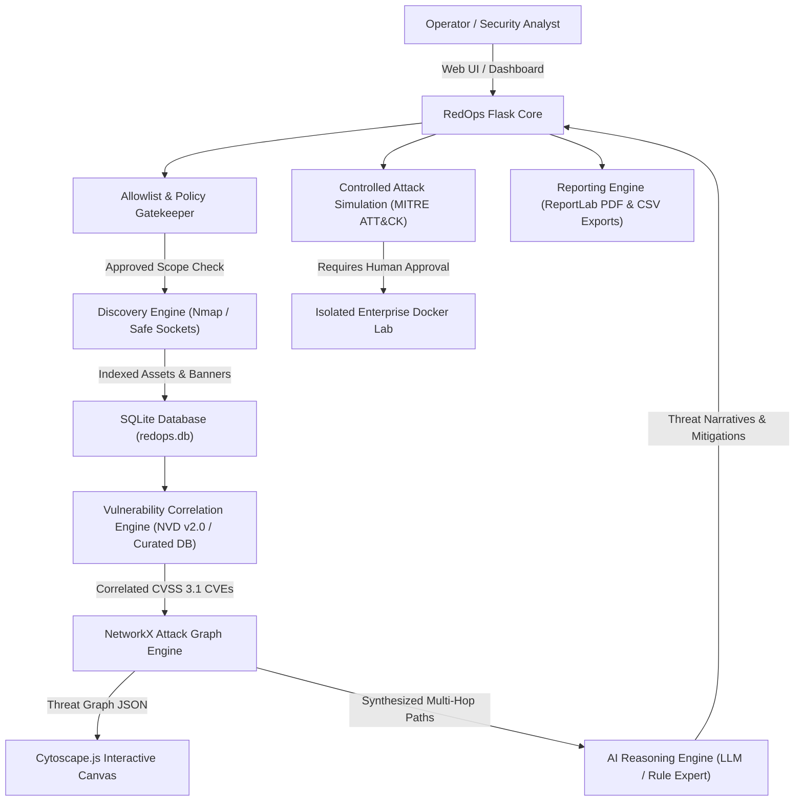

# RedOps – Automated Enterprise Red Team Assessment and Attack Simulation Platform


**RedOps** is an enterprise-grade automated cybersecurity assessment and controlled red team attack simulation platform built as a **B.Tech CSE Cyber Security Project**.

The platform moves beyond basic vulnerability scanning by combining **network asset discovery**, **real-time CVE correlation (NVD v2.0 & CVSS 3.1)**, **graph-theoretic attack-path analysis (NetworkX)**, **interactive topological visualization (Cytoscape.js)**, **explainable AI threat reasoning (LLM & deterministic expert system)**, and **safe, human-authorized simulation (MITRE ATT&CK)**.

---

## Architecture Overview



---

## Technology Stack

| Layer | Technologies Used |
| :--- | :--- |
| **Backend Framework** | Python 3.11+, Flask 3.1 |
| **Database** | SQLite 3 (Foreign keys enforced, dictionary row mapping) |
| **Network Discovery** | Nmap CLI integration + RedOps Safe Socket Scanner fallback |
| **Vulnerability Intel** | NIST NVD API v2.0 client + Curated offline CVE knowledgebase |
| **Graph Modeling** | NetworkX 3.6 (Directed attack graphs, pathfinding, centrality) |
| **Graph Visualization** | Cytoscape.js (Force-directed CoSE, concentric, path highlighting) |
| **AI Reasoning** | Multi-provider LLM connector + Local Rule-Based Security Expert Engine |
| **Security Framework** | MITRE ATT&CK Enterprise Matrix |
| **Reporting** | ReportLab (Executive PDF generation) & CSV data exporters |
| **Charts & Front-End** | Chart.js 4.4, HTML5, CSS3 Cyber Command Dark Theme, JavaScript |
| **Target Lab** | Docker & Docker Compose (Multi-tier enterprise network: 172.28.0.0/16) |

---

## Key Modules & Engineering Depth

### 1. Executive SOC Command Center
- **Live Risk Posture Gauge**: Calculates dynamic posture score (0–100%) weighted by critical asset exposure and CVSS 3.1 base metrics.
- **Interactive Visualizations**: Risk Distribution Doughnut chart and Vulnerability Severity Bar chart rendered via Chart.js.
- **Crown Jewel Prioritization**: Highlights high-value targets (Databases, Domain Controllers) with active critical exposures.
- **Audit & Telemetry Feed**: Real-time event log tracking all discovery, correlation, reasoning, and simulation actions.

### 2. Authorized Asset Discovery Engine
- **Strict Allowlist Scope Enforcement**: Blocks any scanning attempt directed at public Internet IPs or non-allowlisted third-party networks.
- **Hybrid Scanner Engine**: Auto-detects Nmap binary (`-sT -sV -T3 --host-timeout 45s`); falls back to high-performance, non-destructive socket scanning and banner grabbing if Nmap is absent.
- **Lab Discovery Integration**: Seamlessly inventories Docker containers and perimeter hosts.

### 3. Vulnerability & CVE Correlation Engine
- **NVD API v2.0 Integration**: Queries NIST database using keyword criteria with API rate-limit resilience.
- **Authoritative Offline Repository**: Features real, critical vulnerabilities with CVSS 3.1 vectors:
  - `CVE-2022-22965`: Spring4Shell DataBinder RCE (CVSS 9.8)
  - `CVE-2020-1938`: Apache Tomcat AJP Ghostcat File Read/Inclusion (CVSS 9.8)
  - `CVE-2022-0543`: Redis Lua Sandbox Escape Root RCE (CVSS 10.0)
  - `CVE-2020-1472`: Microsoft Netlogon Zerologon Domain Takeover (CVSS 10.0)
  - `CVE-2021-23017`: Nginx 1-Byte Resolver Overwrite (CVSS 8.5)
  - `CVE-2021-42287`: Active Directory sAMAccountName PrivEsc (CVSS 8.8)
  - `CVE-2022-1552`: PostgreSQL Autovacuum Privilege Escalation (CVSS 8.8)
- **Zero Hallucination Guarantee**: Vulnerabilities are correlated strictly against detected software product strings and version banners—never fabricated solely based on open port numbers.

### 4. NetworkX Attack Graph Engine & Cytoscape.js
- Constructs directed multigraphs (`DiGraph`) modeling:
  - `Entrypoints` (External Threat Actors)
  - `Hosts` (Gateway, Web Server, Database, Domain Controller)
  - `Services` (SSH, HTTP, HTTPS, Tomcat, AJP, PostgreSQL, Redis, Kerberos, SMB)
  - `Vulnerabilities` (Correlated CVEs with CVSS weightings)
  - `Edges` (`PERIMETER_PROBE`, `EXPOSES`, `HAS_VULNERABILITY`, `ENABLES_HOST_COMPROMISE`, `LATERAL_INTERNAL_PIVOT`)
- **Path Synthesis**: Computes multi-stage breach routes using simple path algorithms, aggregating chained risk scores.
- **Interactive UI**: Clickable node inspector drawer, layout switcher (CoSE, Breadth-First, Concentric, Circular), and active attack-path glowing edge highlight animations.

### 5. LLM-Based Threat Reasoning Module
- Configurable connector for **OpenAI (GPT-4o-mini)**, **Google Gemini 1.5**, or **Anthropic Claude**.
- **Deterministic Expert Rule Fallback**: When API keys are not provided or the machine is offline, the RedOps Local Rule-Based Security Expert Engine automatically evaluates graph topology to produce:
  1. Multi-stage attack chaining explanations in technical language.
  2. Identified risk factors (flat network topology, unauthenticated ports, exploit availability).
  3. Phased defensive roadmaps (**P0 Immediate**, **P1 High**, **P2 Medium**, **P3 Architectural**).
  4. Transparent label identifying whether remote LLM or local expert engine was utilized.
- **Safety Policy**: Advisory only. The LLM cannot execute shell commands or modify scan permissions.

### 6. Controlled Red Team Simulation Engine
- Harmless, non-destructive tests mapped to the **MITRE ATT&CK** matrix:
  - `SIM-DISC-01`: Safe Network Port & Service Footprinting (T1046)
  - `SIM-ENUM-02`: Host OS Banner & HTTP Header Audit (T1082)
  - `SIM-AUTH-03`: Controlled Default Credential & Exposure Check (T1110.001)
  - `SIM-EXPLOIT-04`: Safe Public Vulnerability Signature Verification (T1190)
  - `SIM-LATERAL-05`: Internal Lateral Pivoting Connectivity Check (T1021.002)
- **Mandatory Operator Authorization**: Enforces human-in-the-loop modal confirmation before execution.
- **Tamper-Evident Audit Logging**: Stores execution logs, operator IDs, timestamps, and findings in SQLite.

### 7. Bounded Assessment Planner
- Evaluates assessment coverage gaps:
  - Unscanned allowlisted targets
  - Incomplete service banner fingerprints
  - Unvalidated critical attack paths
  - Pending database hardening verifications
- Recommends actionable, bounded next steps requiring explicit user approval.

### 8. Executive PDF & CSV Reporting
- Generates publication-quality executive security assessment reports using ReportLab with custom cybersecurity palette, tables, and remediation matrices.
- One-click CSV export of raw vulnerability data and asset inventories for SIEM ingestion.

---

## Installation & Running RedOps

### Prerequisites
- Python 3.11+
- Git (optional)
- Docker & Docker Compose (optional, for live container lab)

### 1. Setup & Environment
The project includes a portable Python runner (`py.cmd`) and launcher (`run.bat`).

```bash
# Clone or navigate to the RedOps folder
cd Redops

# Verify dependencies
.\py.cmd -m pip install -r requirements.txt
```

### 2. Configure Environment (`.env`)
A default `.env` file is pre-configured with safe local lab defaults:

```env
FLASK_ENV=development
FLASK_DEBUG=1
SECRET_KEY=redops-sec-key-cyber-defense-2026
HOST=127.0.0.1
PORT=5000

# Target allowlist (Strictly enforced)
AUTHORIZED_TARGETS=127.0.0.1,172.28.0.0/16,192.168.1.0/24,10.0.0.0/24,localhost
ENFORCE_STRICT_ALLOWLIST=true

# AI Reasoning Engine (Default: local deterministic expert fallback)
AI_PROVIDER=local
OPENAI_API_KEY=
GEMINI_API_KEY=
```

### 3. Launching the Platform
Run the application using the launcher script:

```bash
# Option A: Windows Launcher Batch Script
run.bat

# Option B: Direct Python command
.\py.cmd app.py
```

Open your browser and navigate to:
**`http://127.0.0.1:5000`**

---

## Running the Automated Test Suite

RedOps includes a comprehensive test suite covering input validation, allowlist enforcement, graph pathfinding, CVE correlation, AI reasoning, and Flask API integration.

Execute tests using `pytest`:

```bash
.\py.cmd -m pytest tests/ -v
```

### Test Suite Summary:
```
tests/test_ai_reasoning.py::test_ai_reasoning_analysis PASSED            [  5%]
tests/test_allowlist.py::test_authorized_targets PASSED                  [ 10%]
tests/test_allowlist.py::test_blocked_unauthorized_targets PASSED        [ 15%]
tests/test_allowlist.py::test_empty_target PASSED                        [ 20%]
tests/test_api.py::test_dashboard_page PASSED                            [ 25%]
tests/test_api.py::test_dashboard_stats_api PASSED                       [ 30%]
tests/test_api.py::test_discovery_page PASSED                            [ 35%]
tests/test_api.py::test_vulnerabilities_api PASSED                       [ 40%]
tests/test_api.py::test_graph_elements_api PASSED                        [ 45%]
tests/test_api.py::test_attack_paths_api PASSED                          [ 50%]
tests/test_api.py::test_ai_reasoning_api PASSED                          [ 55%]
tests/test_api.py::test_simulation_scenarios_api PASSED                  [ 60%]
tests/test_api.py::test_unauthorized_scan_rejection PASSED               [ 65%]
tests/test_api.py::test_reports_page PASSED                              [ 70%]
tests/test_cve_correlation.py::test_cve_database_integrity PASSED        [ 75%]
tests/test_cve_correlation.py::test_version_matching PASSED              [ 80%]
tests/test_cve_correlation.py::test_correlation_execution PASSED         [ 85%]
tests/test_graph_engine.py::test_build_networkx_graph PASSED             [ 90%]
tests/test_graph_engine.py::test_attack_path_analysis PASSED             [ 95%]
tests/test_graph_engine.py::test_cytoscape_elements_format PASSED        [100%]

============================= 20 passed in 0.98s ==============================
```

---

## Step-by-Step Viva & Evaluation Demonstration Script

When presenting this project to your college evaluator, follow this flow:

### Step 1: Executive Dashboard (`/`)
- Show the **SOC Dark Theme Command Center**.
- Explain the **Security Posture Score** and how it derives from asset criticality and unmitigated CVSS scores.
- Highlight the **Prioritized Crown Jewels** table (`172.28.0.30` Database and `172.28.0.40` DC).

### Step 2: Policy Enforcement & Asset Discovery (`/discovery`)
- Enter an unauthorized public IP address (e.g. `8.8.8.8`).
- Click **Start Authorized Scan** & demonstrate the **Security Policy Rejection**: RedOps blocks external scans and logs an audit violation.
- Enter the authorized lab subnet (`172.28.0.0/16`) and click **Start Authorized Scan**.
- Observe live terminal telemetry indexing the 4 enterprise tier hosts and 11 open ports.

### Step 3: Vulnerability Correlation & CVSS 3.1 (`/vulnerabilities`)
- Review correlated CVEs (Spring4Shell, Ghostcat, Redis Lua, Zerologon).
- Point out the **Confidence Level** (`CONFIRMED` on exact version matching vs `POTENTIAL`) and emphasize that RedOps never invents vulnerabilities.
- Click **Re-run CVE Correlation** to showcase real-time database indexing.

### Step 4: NetworkX Threat Graph & Cytoscape.js (`/attack-graph`)
- Display the interactive graph canvas with distinct color-coded nodes.
- Click on any node to demonstrate the **Node Inspection Drawer** showing host OS, ports, and remediation advice.
- Select the **Primary Enterprise Compromise Chain** from the top dropdown to trigger the glowing animated attack path highlight.
- Switch layout algorithms (Force-Directed CoSE vs Concentric).

### Step 5: AI-Based Threat Reasoning (`/ai-reasoning`)
- Click **Synthesize Threat Narrative**.
- Explain the multi-stage attack chaining narrative produced by the AI reasoning engine.
- Review the **Risk Factors** and the **Phased Defensive Roadmap (P0 to P3)**.
- Highlight the transparency of the fallback engine label and advisory safety boundaries.

### Step 6: Controlled Attack Simulation (`/simulation`)
- Review approved scenarios mapped to **MITRE ATT&CK** (`T1046`, `T1082`, `T1110.001`, `T1190`, `T1021.002`).
- Click **Authorize & Run** on `SIM-EXPLOIT-04` (Spring4Shell canary signature probe).
- Complete the **Human-in-the-Loop Operator Authorization Modal**.
- Observe safe execution logs stream into the console with zero persistent state alteration.

### Step 7: Bounded Assessment Planner (`/planner`)
- Review identified coverage gaps (e.g., pending database verification).
- Click **Approve & Execute** on a planned assessment phase and observe its status transition to `COMPLETED`.

### Step 8: Executive Report Generation (`/reports`)
- Click **Download Executive PDF Report**.
- Open the generated PDF to present the title banner, executive summary, scope table, asset inventory, CVE details, graph attack paths, AI threat narrative, and remediation roadmap.
- Download the CSV files to show SIEM data portability.

---

## Safety & Authorized Assessment Policy

RedOps is developed strictly for **authorized defensive assessment, security posture evaluation, educational threat modeling, and controlled enterprise laboratory exercises**:
- Non-destructive test conditions only.
- Strict scope allowlist enforcement.
- Human authorization required prior to simulated tests.
- Zero weaponized exploit payloads or credential dumping.
